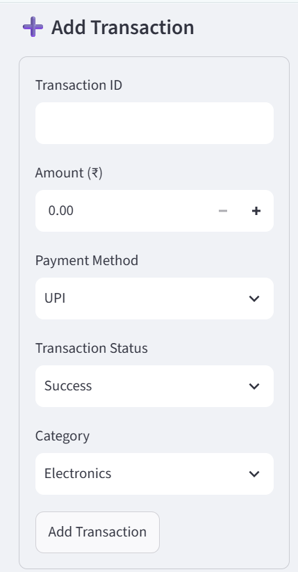
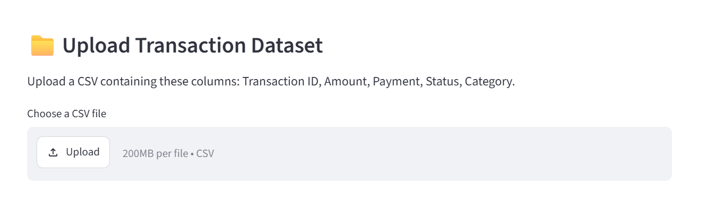
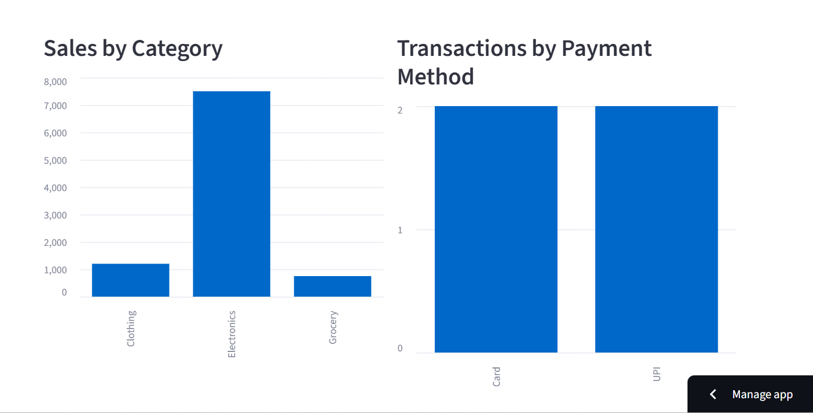
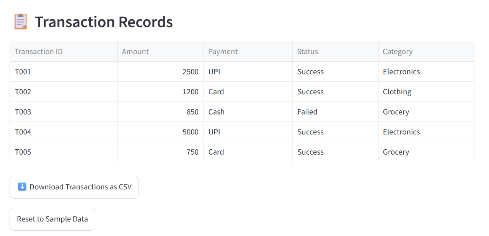

# 🛒 E-Commerce Transaction Analysis

<p align="center">
  <b>An Interactive Big Data Analytics Dashboard using Hadoop MapReduce and Streamlit</b>
</p>

<p align="center">
  
  
  
  
  
</p>

## 🌐 Live Demo

**Live Website:** [E-Commerce Transaction Analysis Dashboard](https://ecommerce-bda-8sfxancy7yprff7nuqwq2r.streamlit.app/)

## 📌 Overview

E-Commerce Transaction Analysis is a Big Data Analytics mini project designed to analyze transaction records, evaluate sales performance, identify failed transactions, and visualize category-wise sales and payment trends.

The project combines a Java-based Hadoop MapReduce implementation with a Python Streamlit dashboard to present transaction analytics through an interactive web interface.

## 🎯 Objectives

- Analyze e-commerce transaction records.
- Calculate transaction values and successful sales.
- Identify failed transactions.
- Analyze sales across product categories.
- Compare successful transactions by payment method.
- Present analytical results using interactive charts and metrics.

## ✨ Features

- **Interactive Dashboard:** View transaction metrics and sales summaries.
- **Transaction Entry:** Add transactions through a form.
- **Sales Analytics:** Visualize successful sales by product category.
- **Payment Analysis:** Compare successful transactions by payment method.
- **Transaction Monitoring:** View transaction records and failed transaction counts.
- **CSV Download:** Export dashboard transaction records.
- **Live Deployment:** Access the dashboard through a public URL.

## 🔄 Workflow

1. Collect or upload e-commerce transaction data.
2. Process transaction records using the project's data analysis workflow.
3. Analyze transaction amounts, statuses, categories, and payment methods.
4. Calculate summary metrics and aggregate values.
5. Display results through the Streamlit dashboard.

> **Note:** The currently deployed dashboard calculates its displayed metrics using Python and Pandas. The live transaction form has not yet been verified as directly triggering Hadoop MapReduce jobs.

## 🛠️ Technologies Used

| Technology | Purpose |
|---|---|
| Python | Dashboard logic and data analysis |
| Java | MapReduce implementation |
| Hadoop MapReduce | Distributed data processing component |
| Streamlit | Interactive web application |
| Pandas | Tabular data processing |
| Git and GitHub | Version control and project hosting |
| Streamlit Community Cloud | Web application deployment |

## 📊 Dashboard Results

The dashboard displays:

- Total number of transactions
- Total transaction value
- Successful sales amount
- Failed transaction count
- Category-wise successful sales
- Successful transactions by payment method
- Transaction records

Results change when new transactions are added through the dashboard. The displayed values depend on the current dashboard dataset.

## 🚀 Run Locally

### Prerequisites

- Python 3
- pip
- Git

### Installation

**1. Clone the repository**

```bash
git clone https://github.com/RakshitaMahesh/ecommerce-bda.git
cd ecommerce-bda
```

**2. Install dependencies**

```bash
pip install -r requirements.txt
```

**3. Run the Streamlit application**

```bash
streamlit run src/app.py
```

**4. Open the local website**

```text
http://localhost:8501
```

## 📁 Project Structure

```text
ecommerce-bda/
├── src/
│   ├── app.py
│   └── EcommerceAnalysis.java
├── input/
├── docs/
├── screenshots/
├── requirements.txt
├── dashboard.html
├── README.md
├── results.txt
└── final_results.txt
```

*The structure above represents the intended organization; only files actually uploaded to GitHub will be available in the repository.*

## 🔮 Future Enhancements

- Connect the Streamlit dashboard directly to Hadoop MapReduce execution.
- Integrate persistent storage for transaction records.
- Support larger datasets and additional analytical reports.
- Add advanced filtering and transaction search.
- Improve deployment and data-processing integration.

## ⚠️ Limitations

- Dashboard transactions are maintained in the Streamlit session and are not guaranteed to persist after a session resets.
- The current dashboard's analytics run in Python and Pandas.
- Direct integration between live transaction entry and Hadoop MapReduce remains a future enhancement.

  ## Screenshots

### 1. Dashboard Overview


### 2. Dataset Upload


### 3. Transaction Analysis


### 4. Transaction Records


### 5. Add Transaction


## 👩‍💻 Author

**Rakshita M**

Big Data Analytics Mini Project — E-Commerce Transaction Analysis

## 🔗 Project Links

- **Live Demo:** https://ecommerce-bda-8sfxancy7yprff7nuqwq2r.streamlit.app/
- **GitHub Repository:** https://github.com/RakshitaMahesh/ecommerce-bda
